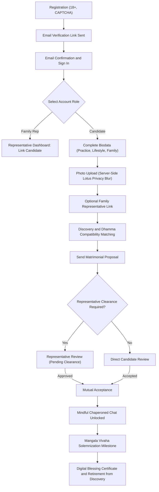

# Global Maitri — Architecture and Technical Documentation

> **Note**: This document provides a complete technical specification, architectural guide, database schema, user roles, security framework, and lifecycle workflows for the Global Maitri Buddhist Matrimonial Platform.

---

## Table of Contents
1. [Platform Vision and Core Philosophy](#1-platform-vision-and-core-philosophy)
2. [Technology Stack and Architecture](#2-technology-stack-and-architecture)
3. [User Roles and Permissions System](#3-user-roles-and-permissions-system)
4. [Complete User Lifecycle](#4-complete-user-lifecycle)
   - 4.1 Registration and Age Verification
   - 4.2 Email Verification and Security
   - 4.3 Profile and Dhamma Alignment
   - 4.4 Lotus Modesty and Photo Privacy Protection
   - 4.5 Family Representative (Kalyana-Mitta) Workflow
   - 4.6 Discovery and Compatibility Matching Engine
   - 4.7 Daily Quotas and Single Marriage Pass
   - 4.8 Matrimonial Proposals (Interest Requests)
   - 4.9 Chaperoned Mindful Messaging
   - 4.10 Bookmarks, Notes, and Profile Visitors
   - 4.11 Identity Verification and KYC
   - 4.12 Reporting and Safety Controls
   - 4.13 Mangala Vivaha Milestone and Account Completion
5. [Packages and Subscription Engine](#5-packages-and-subscription-engine)
6. [Administration and Governance Suite](#6-administration-and-governance-suite)
7. [Database Models and Relationships](#7-database-models-and-relationships)
8. [Real-Time Events and Broadcasting (WebSockets)](#8-real-time-events-and-broadcasting)
9. [RESTful API (Sanctum)](#9-restful-api)
10. [Security, Privacy, and Compliance](#10-security-privacy-and-compliance)

---

## 1. Platform Vision and Core Philosophy

**Global Maitri** is an ethical Buddhist matrimonial platform designed for earnest candidates and families seeking lifelong companionship. In contrast to modern swipe-based dating applications, the platform is grounded in:
1. **Loving-Kindness (Metta) First**: Respectful, non-judgmental communication and genuine intention.
2. **Lotus Modesty Protection**: Server-side photo shielding and blur controls to emphasize inner character, Dhamma practice, and values before physical appearance.
3. **Family and Elder Participation**: Free participation for parents and mentors (Kalyana-Mitta) to ensure family harmony and transparency.
4. **Casteless and Anti-Dowry Equality**: Strict prohibition of caste discrimination and dowry demands in alignment with universal Buddhist ethics.
5. **Single Marriage Pass**: A one-time payment valid until the confirmed Mangala Vivaha wedding blessing, eliminating predatory recurring subscriptions.

---

## 2. Technology Stack and Architecture

* **Backend Framework**: Laravel 12.x / 13.x (PHP 8.3 / 8.4)
* **Database**: PostgreSQL 16 (Production) / SQLite / MySQL 8.x
* **Frontend**: Blade Templating, Tailwind CSS v4, Alpine.js, Vite
* **Real-Time Broadcasting**: Laravel Reverb + Laravel Echo
* **API and Authentication**: Laravel Sanctum (Bearer Token)
* **Payment Gateways**: Stripe, PayPal REST API, and Developer Simulation
* **Bot Protection**: CAPTCHA and rate-limiting
* **Image Processing**: GD Library (WebP conversion, downscaling, and Gaussian blur)

---

## 3. User Roles and Permissions System

| Role | Description | Key Responsibilities |
|---|---|---|
| **Super Admin** | Platform Administrator | Configures policies, manages payment gateways, creates promo codes, manages staff permissions, reviews immutable audit logs. |
| **Moderator** | Trust and Safety Staff | Reviews government ID credentials and photo liveness (KYC) to award Verified badges; handles user safety reports. |
| **Candidate (Seeker)** | Marriage Seeker | Completes biodata, searches candidate profiles, sends respectful proposals, communicates via chaperoned chat, manages privacy settings. |
| **Family Representative** | Parent, Elder, or Mentor | Reviews incoming proposals, guides candidates, and participates as a chaperone. Completely free for life. |

### Staff Permission Keys:
- `manage_verifications`: KYC document review and verification approval.
- `manage_reports`: Moderating safety reports, warnings, and suspensions.
- `view_audit_logs`: Reviewing administrative and security audit trails.
- `manage_settings`: Updating platform parameters and policies.

---

## 4. Complete User Lifecycle

---

## 5. Packages and Subscription Engine

The platform operates on a **Single Marriage Pass** paradigm:
- **Free Explorer**: Basic discovery, daily view quotas, receiving proposals.
- **Pro Single Marriage Pass**: One-time payment until wedding, unlimited views, advanced Dhamma filters, read receipts.
- **VIP Maitri Blessing Pass**: Includes profile spotlight and personal onboarding assistance.

---

## 6. Administration and Governance Suite

- `/admin/dashboard`: Metrics, KYC queue status, recent reports, audit highlights.
- `/admin/verifications`: Document review with privacy-safe viewports.
- `/admin/reports`: Triage and disciplinary actions for dowry demands, caste bias, or harassment.
- `/admin/staff`: Granular RBAC delegation for moderators and compliance officers.
- `/admin/audit-logs`: Immutable logging of all sensitive administrative operations.

---

## 7. Database Models and Relationships

Key Eloquent Models:
- `User`: Core authentication, role, verified badge, and relationship linkages.
- `Profile`: Demographics, tradition, meditation rhythm, Five Precepts observance, and privacy modes.
- `Photo`: Multi-photo support with server-side Gaussian blur caching and moderation states.
- `Interest`: Proposal requests, statuses (`pending`, `accepted`, `declined`), and chaperone clearance.
- `Conversation` & `Message`: Real-time chat messages with contact-filtering and audit tracking.
- `WaliLink`: Family representative permission mappings and invitation tokens.
- `Marriage`: Mangala Vivaha milestone records, mutual declarations, and digital certificates.
- `Subscription` & `SubscriptionPlan`: Single Marriage Pass billing records and transaction logs.
- `AuditLog`: Security audit trail capturing actor, target, IP address, and changed attributes.

---

## 8. Real-Time Events and Broadcasting

Laravel Reverb powers live WebSocket channels:
- `private-App.Models.User.{id}`: Personal notifications (proposals, acceptances, milestone alerts).
- `private-conversation.{id}`: Real-time chat delivery and typing indicators.

---

## 9. RESTful API

Sanctum-authenticated endpoints for mobile applications and headless clients:
- `POST /api/v1/auth/login`: Issue bearer tokens.
- `GET /api/v1/discover/candidates`: Paginated candidate discovery with Dhamma filters.
- `GET /api/v1/profiles/{id}`: Detailed candidate biodata view.
- `POST /api/v1/interests/{id}/respond`: Accept or decline proposals.
- `GET /api/v1/conversations/{id}/messages`: Chat message history.
- `POST /api/v1/conversations/{id}/messages`: Send real-time chat messages.

---

## 10. Security, Privacy, and Compliance

1. **Security Headers**: HSTS, X-Content-Type-Options: nosniff, X-Frame-Options: SAMEORIGIN, Referrer-Policy.
2. **Rate Limiting**: Tiered limits on authentication, registration, chat messaging, and image viewports.
3. **Data Protection & Right to Erasure**: Full account deletion service removing original photos, identity cards, and conversations.
4. **Modesty Shield**: Automated server-side photo blurring preventing unauthorized caching of unblurred candidate faces.
